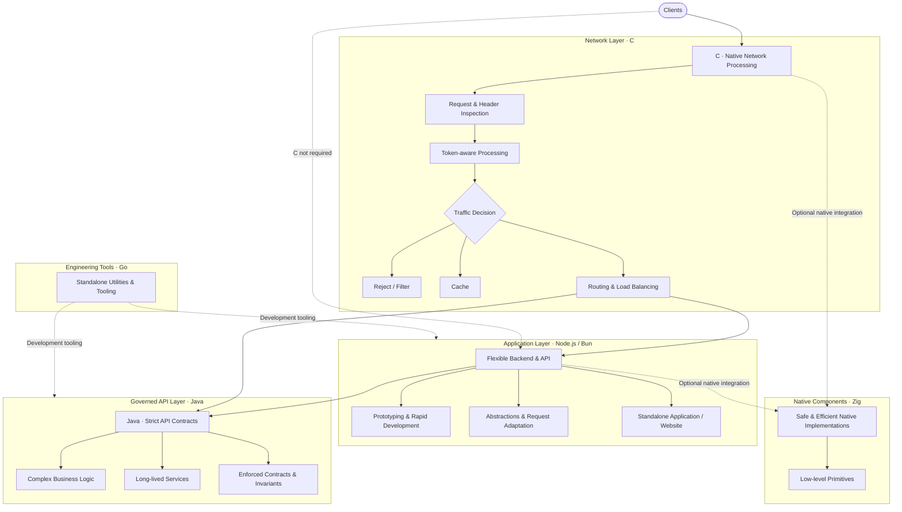

### Systems Engineering Research

I explore programming languages and runtime environments as complementary tools for designing efficient, maintainable and scalable systems.

- **C** — network infrastructure, API-aware reverse proxies, traffic filtering and performance-critical processing.
- **Zig** — safe, resource-efficient native components and low-overhead abstractions where native implementation is advantageous.
- **Go** — standalone engineering tools, utilities and development infrastructure.
- **Node.js / Bun** — flexible backend development, rapid prototyping, frequently evolving application logic and API abstraction.
- **Java** — long-lived services, complex infrastructure, scalable APIs and strongly governed contracts designed for consistency and maintainability.

The underlying approach is to distribute responsibilities according to execution efficiency, development velocity and long-term maintenance costs. Components may operate independently or coexist, with each runtime selected according to the requirements and economics of its role.

